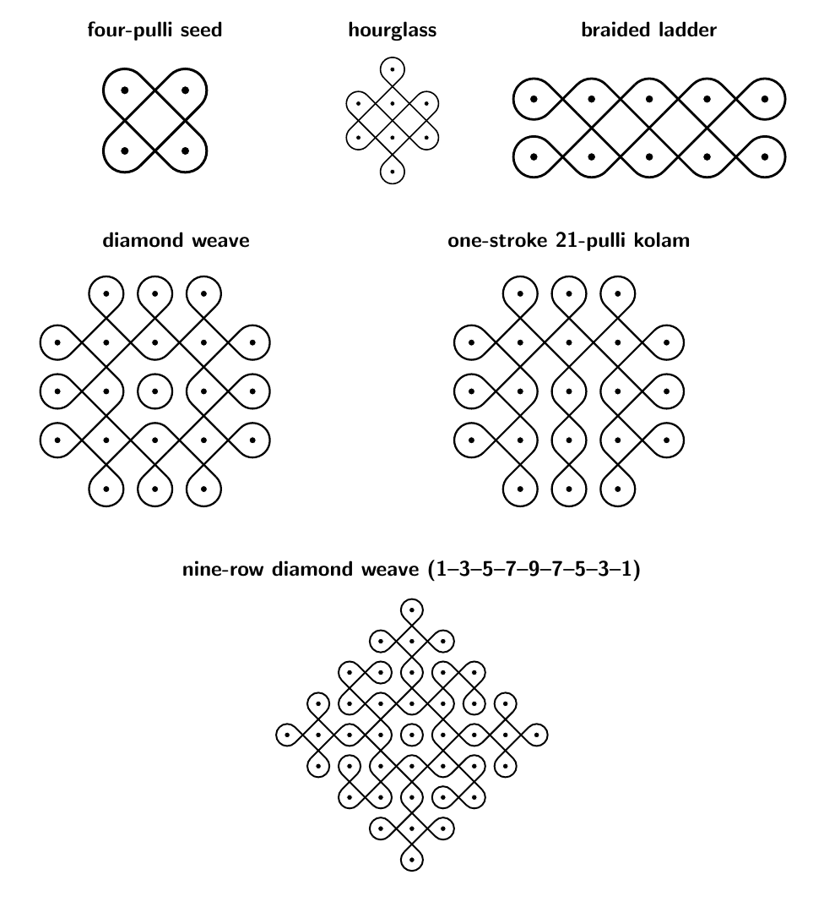

# kolam-tikz

A coordinate-first TikZ package for clean, auditable pulli kolam drawings.
Declare the pulli at integer coordinates, label the cardinal gates between
them, and let the package construct the smooth, complete strands.

<code>kolam-tikz</code> is an initial public release (0.1.0). It is designed
for research figures, teaching material, and reproducible ornamental drawings.

## Scope and respect

Pulli kolam is a living family of practices with regional vocabularies and
many ways of learning and making. This package supplies one deliberately
narrow formal drawing language inspired by pulli kolam. It does not claim to
define, exhaust, or replace the broader cultural practice.

## Quick start

~~~tex
\documentclass[tikz,border=4pt]{standalone}
\usepackage{kolam-tikz}

\begin{document}
\begin{tikzpicture}[kolam grid]
  \begin{kolam}
    \KolamSetup{turn radius=exact,line width=1.2pt,dot size=4.2pt}
    \KolamPulli{0}{0}
    \KolamPulli{1}{0}
    \KolamPulli{0}{1}
    \KolamPulli{1}{1}
    \KolamOpenGate{0}{0}{1}{0}
    \KolamOpenGate{0}{1}{1}{1}
    \KolamOpenGate{0}{0}{0}{1}
    \KolamOpenGate{1}{0}{1}{1}
    \KolamRender
  \end{kolam}
\end{tikzpicture}
\end{document}
~~~

The public grammar is coordinate-first:

- <code>\KolamPulli{x}{y}</code> declares a pulli at an integer coordinate.
- <code>\KolamOpenGate{x}{y}{u}{v}</code> or
  <code>\KolamClosedGate{x}{y}{u}{v}</code> sets the state of one horizontal
  or vertical unit gate.
- Every omitted induced gate is <code>closed</code>.
- <code>\KolamRender</code> draws all strands and pulli from those
  declarations.

An apparent <code>X</code> in the rendered picture is a crossing of two
tracks, not a new graph vertex or a strand connection. The port graph, not
visual contact, defines connectivity.

Read the precise [formal grammar](docs/grammar.md) and the full
[API reference](docs/api.md) before extending the vocabulary.

## Installation

### Use directly from this checkout

From the package root, keep your document beside <code>tex/</code> and run:

~~~sh
TEXINPUTS=./tex: latexmk -pdf my-kolam.tex
~~~

Or place <code>kolam-tikz.sty</code> beside your document and use the usual
<code>\usepackage{kolam-tikz}</code> command.

### Install in a personal TeX tree

Copy <code>tex/kolam-tikz.sty</code> into a directory such as
<code>$(kpsewhich -var TEXMFHOME)/tex/latex/kolam-tikz/</code>. Refresh the
filename database if your TeX distribution requires it, then compile normally.

## Geometry and style

The <code>kolam grid</code> TikZ style fixes the intended unit grid to
<code>1cm</code> in both directions. The default
<code>turn radius=exact</code> uses

$$
r=\frac{1}{2\sqrt2}
$$

and an exactly assigned 45-degree port angle. That makes adjacent tangent
tracks collinear rather than merely numerically close. For a different
appearance, set <code>radius=&lt;number&gt;</code> with
<code>0 &lt; radius &lt; .5</code>.

Use a uniform TikZ <code>scale=&lt;factor&gt;</code> to resize a motif. Do not
resize by changing <code>x</code> or <code>y</code> independently: TikZ stores
arc radii as physical dimensions, so a changed coordinate basis would
desynchronize the arcs and tangent ports.

Declarations are safe inside TikZ <code>\foreach</code> loops. The examples
intentionally spell their declarations out so the independent auditor can
inspect them without interpreting arbitrary TeX.

## Examples

Start with the small seed and proceed through increasingly structured motifs.

| Source | Motif | Independently checked property |
| --- | --- | --- |
| 01-minimal-loop.tex | four-pulli seed | two closed strokes |
| 02-hourglass.tex | eight-pulli hourglass | one closed stroke |
| 03-braided-ladder.tex | ten-pulli braided ladder | one stroke; Drop-Fan |
| 04-diamond-weave.tex | 21-pulli diamond weave | three closed strokes |
| 05-one-stroke-21.tex | 21-pulli opening motif | one closed stroke |
| 07-nine-row-diamond.tex | 41-pulli 1–3–5–7–9–7–5–3–1 diamond | three closed strokes |
| 06-gallery.tex | labelled contact sheet | renders the six motifs |

The examples directory contains source and intentionally committed vector PDFs.
See its [guide](examples/README.md) for direct compilation details.

## Build, test, and preview

Requirements:

- LaTeX2e with PGF/TikZ;
- <code>latexmk</code> and <code>make</code> for the convenience targets;
- Python 3.9 or later for the independent grammar auditor;
- Poppler's <code>pdftoppm</code> only when regenerating the README preview.

From the package root:

~~~sh
make all       # build the six example PDFs and the contact sheet
make check     # audit the advertised stroke certificates
make test      # run Python regression tests and the TikZ foreach smoke test
make verify    # run the complete publication check
make preview   # regenerate docs/assets/gallery.png from the vector gallery
make tidy      # remove LaTeX intermediates while retaining PDFs
~~~

The auditor reconstructs the eight-port graph independently of TikZ:

~~~sh
python3 tools/kolam-audit.py examples/05-one-stroke-21.tex --require-one
python3 tools/kolam-audit.py examples/03-braided-ladder.tex --drop-fan --require-one
~~~

It intentionally accepts only the explicit public grammar used by the shipped
examples: <code>\KolamPulli</code>, <code>\KolamGate</code>,
<code>\KolamOpenGate</code>, <code>\KolamClosedGate</code>, and
<code>\KolamThreeFiveFiveFiveThree</code>.

## Project layout

~~~text
tex/kolam-tikz.sty       package implementation
docs/grammar.md          formal semantics and geometric model
docs/assets/gallery.png  README preview
examples/                source motifs and vector PDFs
tools/kolam-audit.py     independent finite-state auditor
tests/                   auditor and TikZ regression tests
~~~

See [CONTRIBUTING.md](CONTRIBUTING.md) for development expectations and
[CHANGELOG.md](CHANGELOG.md) for release notes. <code>kolam-tikz</code> is
licensed under the [MIT License](LICENSE).
